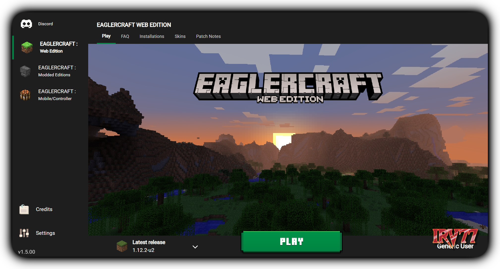

#  Cake Launcher BETA
 A minecraft themed launcher for Eaglercraft! 
 Containing some of the best clients all in one place!
 fork of ampler launcher

 

 ## Versions
 __BETA 1.0__ - Added new images, replaced PLAY button. (sorry for grainy pictures on the launcher btw) 
 
 

## Installation
 Currently just download the repository for the source code! 
 Future plans for an offline file may be possible!

## Features Planned

Click here to expand feature list

- [ ] Add the servers screen
- [x] Add Credits screen
- [x] Add Settings screen
- [x] Rewrite some of the css and js
- [x] Organize code, and add comments
- [x] Add a customizable launcher selector
- [x] Save last played game
- [x] Add FAQ screen
- [x] Add Installations screen
- [x] Add Mods screen
- [ ] Add Skins screen
- [x] Add Patch Notes screen
- [ ] Fix display errors
- [ ] Offline launcher download?

>__Finally [here](https://isuckatcpvp.github.io/) is the live version of the code!__
